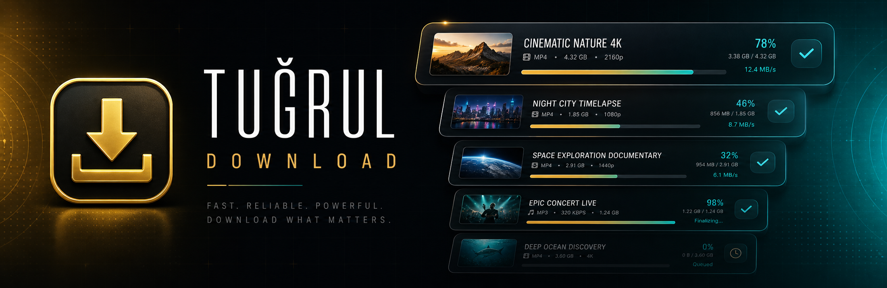

<div align="center">



# TUĞRUL DOWNLOAD

**yt-dlp motoruyla çalışan, AAA kalitede video & ses indirme stüdyosu.**
Bağlantıyı bırak — çözümle, formatı seç, indir, kes, dönüştür, arşivle.

`yt-dlp` · `FastAPI` · `React 18` · `TypeScript` · `Tailwind` · `FFmpeg` · `SQLite` · `Capacitor`

[](https://keykavus324-svg.github.io/TUGRUL-DOWNLOAD/)


[](https://github.com/keykavus324-svg/TUGRUL-DOWNLOAD/releases/latest)

**[Web demosu](https://keykavus324-svg.github.io/TUGRUL-DOWNLOAD/)** (sunucusuz motor, kurulum yok) ·
**[Android APK v1.0.0](https://github.com/keykavus324-svg/TUGRUL-DOWNLOAD/releases/download/v1.0.0/tugrul-download-1.0.0-debug.apk)** (5,4 MB) ·
**[Tam sürüm paketi](https://github.com/keykavus324-svg/TUGRUL-DOWNLOAD/releases/download/v1.0.0/tugrul-download-web.tar.gz)** (gerçek yt-dlp indirmeleri)

</div>

---

> **Yayın durumu.** Statik demo `https://keykavus324-svg.github.io/TUGRUL-DOWNLOAD/`
> adresinde yayında (kaynak: `gh-pages` dalı, HTTPS zorunlu). APK ve sunucu paketi
> **[Releases](https://github.com/keykavus324-svg/TUGRUL-DOWNLOAD/releases/latest)** sayfasında.
>
> **Bağlantıyı yapıştırın, indirme başlasın.** Statik sürüm (Pages/APK) bağlantıyı
> sunucusuz **yt-dlp proxy** ucuna (`vercel-api/`) gönderir; dosya parça parça cihaza iner
> ve tek dokunuşla kaydedilir. Kuyruk, ilerleme, duraklat/devam ve kalıcılık cihazda çalışır.
> FFmpeg stüdyosu ve toplu işler için tam sürümü çalıştırın: `bash scripts/start.sh`.


## Neden TUĞRUL?

Android'in en olgun yt-dlp uygulaması [**YTDLnis**](https://github.com/deniscerri/ytdlnis)'in
ürün mantığından ilham alan (kuyruk, format seçimi, şablonlar, izleme listesi, sponsorblock,
altyazı gömme, söz arama…), fakat **her cihazda** çalışan, tek komutla kurulan bir
indirme stüdyosu. yt-dlp'nin 1000+ site desteği, FFmpeg'in medya gücü ve modern bir
arayüzün birleşimi.

| | |
|---|---|
| 🌍 **1000+ site** | YouTube, Instagram, TikTok, X, Twitch, Vimeo, Reddit, SoundCloud, Dailymotion, doğrudan medya bağlantıları… |
| 🎚️ **Tam format kontrolü** | Her video/ses akışı ayrı listelenir; çözünürlük, fps, codec, boyut, HDR bilgisiyle |
| ⚡ **Gerçek kuyruk** | Eşzamanlı indirme, sıralama, duraklat/devam, iptal, yeniden dene, otomatik kurtarma |
| ✂️ **Stüdyo** | Kesit, kırpma, format dönüştürme (mp4/mkv/webm/mp3/flac/wav/gif…), GIF üretimi |
| 🎵 **Ses iş akışı** | mp3/m4a/opus/flac/wav, VBR kalite, kapak + etiket + bölüm gömme |
| 📝 **Sözler** | [lrclib.net](https://lrclib.net) üzerinden senkron/sade söz arama, `.lrc` veya dosyaya gömme |
| 📚 **Oynatma listeleri** | Tek tek veya toplu seçim, aralık filtresi, 500 öğeye kadar toplu kuyruk |
| 🔎 **Keşfet** | YouTube araması, geçmiş, tek tıkla format kartı |
| 🛡️ **SponsorBlock** | Reklam/ınro/outro bölümlerini işaretle ya da kesip çıkar |
| 💬 **Altyazı** | Çok dilli altyazı indirme ve videoya gömme |
| 🕵️ **Gizli mod** | Geçmiş, günlük ve arama kaydı tutulmaz |
| 🗂️ **Yedekleme** | Ayarlar + şablonlar + izleme listesi + geçmiş tek JSON dosyada |
| 🔐 **Çerez desteği** | Özel / yaş kısıtlı içerik için `cookies.txt` yükleme |
| 🌐 **Proxy & hız sınırı** | Kurumsal ağlar ve bant genişliği dostu kullanım |
| 🎨 **Arayüz** | Abanoz + altın tema, açık tema, mobil uyumlu, canlı SSE ilerlemesi |

---

## Hızlı başlangıç

### Tek komut (önerilen)

```bash
git clone <bu-repo> tugrul-download && cd tugrul-download
bash scripts/start.sh
# → http://localhost:8000
```

`start.sh` eksik Python/Node bağımlılıklarını kurar, arayüzü derler ve sunucuyu başlatır.

### Android APK

```bash
export ANDROID_HOME=$HOME/Android/Sdk
bash scripts/build-apk.sh            # → dist-apk/tugrul-download-1.0.0-debug.apk
```

Hazır APK: **[Releases](https://github.com/keykavus324-svg/TUGRUL-DOWNLOAD/releases/latest)**.
Ayrıntılar ve iki çalışma modu: [docs/ANDROID.md](docs/ANDROID.md).

### Statik yayın (GitHub Pages)

`main` dalına her push'ta `.github/workflows/pages.yml` arayüzü `--mode ghpages`
ile derler, **gerçek indirme akışını test eder** ve Pages'e yayınlar:
<https://keykavus324-svg.github.io/TUGRUL-DOWNLOAD/>

```bash
# yerelde aynı çıktıyı görmek için
npm --prefix frontend run build:ghpages && npx --prefix frontend vite preview --mode ghpages
```

### Docker

```bash
docker build -t tugrul-download .
docker run --rm -p 8000:8000 -v "$PWD/downloads:/app/downloads" tugrul-download
```

### Geliştirme modu

```bash
npm run setup     # node + pip bağımlılıkları
npm run dev       # API :8000 + derlenmiş arayüz
# veya canlı yenileme için iki terminal:
PYTHONPATH=backend python3 -m tugrul.main       # API :8000
npm --prefix frontend run dev                   # Vite :5173 (proxy'li)
```

### Gereksinimler

* Python **3.10+** (3.11/3.12 önerilir)
* Node **18+** (yalnızca arayüz derlemek için)
* FFmpeg — **otomatik**: `imageio-ffmpeg` ile gelir. İsterseniz `FFMPEG_PATH=/usr/bin/ffmpeg` verin.

---

## Mimari

```
┌─────────────────────────────┐        SSE /api/events        ┌──────────────────────────┐
│  React + TS arayüz (Vite)   │ ◀───────────────────────────▶ │  FastAPI (backend/tugrul)│
│  HashRouter · Tailwind      │        REST /api/*            │  api.py     REST + SSE   │
│  store.tsx (canlı durum)    │                               │  manager.py kuyruk motoru│
└─────────────────────────────┘                               │  media.py   yt-dlp köprü │
                                                              │  tools.py   FFmpeg araç  │
                                                              │  demo.py    demo üretici │
                                                              │  db.py      SQLite       │
                                                              └────────────┬─────────────┘
                                                                           │
                                                      ┌────────────────────┴────────────────┐
                                                      │ yt-dlp · FFmpeg · downloads/ · data/ │
                                                      └─────────────────────────────────────┘
```

* **Kuyruk motoru** (`manager.py`): N eşzamanlı worker, iş parçacığında çalışan yt-dlp,
  ilerleme kancaları → SQLite → SSE. Duraklatma, yt-dlp'nin `DownloadCancelled`
  mekanizmasıyla `.part` dosyasını koruyarak yapılır; devam ettirme kaldığı yerden sürer.
* **Kalıcılık**: tek dosya SQLite (`data/tugrul.db`, WAL). Sunucu yeniden başlarsa
  yarım kalan işler otomatik kuyruğa döner.
* **Arayüz**: `EventSource` ile canlı ilerleme; sayfa yenilemeye gerek yok.

Ayrıntılar: [docs/ARCHITECTURE.md](docs/ARCHITECTURE.md) · [API](docs/API.md) · [Android](docs/ANDROID.md)

---

## Özellik turu

### 1. İndir
Bağlantıyı yapıştır → video/ses sekmelerinde akışları gör → indir. Kapak, süre,
yükleyen, izlenme, bölüm listesi ve altyazı dilleri otomatik gelir. Üstteki
**hızlı indirme çubuğu** her sayfadan tek satırla indirme başlatır.

### 2. Keşfet
YouTube araması; sonuç kartına dokununca format kartı açılır.

### 3. Kütüphane
İndirme geçmişi (tarihe göre gruplu, arama + filtre) ve **Dosyalar** görünümü:
boyut, tarih, oynat/indir/stüdyoda aç/sil.

### 4. Kuyruk
Aktif / sırada / duraklatılan / biten işler; tümünü duraklat-devam, toplu temizleme.

### 5. Stüdyo
Kesit (yeniden kodlamalı ya da kayıpsız), kırpma, format dönüştürme, GIF, söz
arama + gömme. Tüm işlemler sunucudaki FFmpeg ile yapılır, çıktı kütüphaneye düşer.

### 6. Zamanla · İzle · Şablonlar
Tarih/saat bazlı indirme; kanal/liste izleme; tekrar kullanılabilir yt-dlp argüman
şablonları (6 hazır şablonla birlikte).

### 7. İstatistik
7 günlük grafik, video/ses dağılımı, başarı oranı, disk kullanımı, sistem günlüğü.

### 8. Ayarlar
Klasör, eşzamanlılık, parça sayısı, yeniden deneme, dosya adı şablonu, gömme
seçenekleri, altyazı dilleri, SponsorBlock, hız sınırı, proxy, çerez, tema,
yedek al/geri yükle.

---

## İndirme motoru (Pages / APK)

İki katman birlikte çalışır:

* **Cihaz katmanı** — `frontend/src/offline.ts`, `/api/*` çağrılarını yakalayan bir
  _sanal sunucudur_: kuyruk, ilerleme, duraklat/devam, kalıcılık (IndexedDB), ayarlar,
  şablonlar, zamanlama, izleme listesi ve yedekleme tarayıcıda/WebView'da çalışır.
* **Motor katmanı** — `frontend/src/proxy.ts`, gerçek indirmeyi sunucusuz yt-dlp
  ucundan yapar:

  ```
  POST /api/info     bağlantıyı çözer (başlık, süre, formatlar)
  POST /api/resolve  seçilen akış için imzalı doğrudan adres üretir
  GET  /api/stream   imzalı adresten bayt aralığı (parça parça, ~1.5 MB)
  GET  /api/health   motor durumu     GET /api/probe  tek istekte uçtan uca test
  ```

  Dosya tarayıcıda birleştirilip Blob olarak kaydedilir. Belirteçler HMAC ile
  imzalıdır ve hedef adres izin listesiyle sınırlıdır — uç açık bir proxy değildir.

Ortak uç: `https://tugrul-run-tugrul1.vercel.app/api/index` (Ayarlar → **İndirme motoru**
alanından değiştirilebilir). Kendi ucunuzu yayınlayın:

```bash
cd vercel-api && vercel deploy --prod          # ya da vercel-api/ klasörünü Vercel'e taşıyın
# çerez gerektiren siteler için:  vercel env add YTDLP_COOKIES_B64
```

> **Vercel notu.** Proje ayarlarındaki _Deployment Protection_ açıkken `*.vercel.app`
> adresleri Vercel girişi ister ve uygulama motora ulaşamaz. **Project Settings →
> Deployment Protection → "Only Preview Deployments"** yapın. Doğrulama:
> `https://<projeniz>.vercel.app/api/index/api/probe?url=https://www.youtube.com/watch?v=dQw4w9WgXcQ`

APK'da **Ayarlar → Yerel sunucu** alanına `http://<bilgisayar-ip>:8000` yazarsanız
telefon, kendi ağınızdaki tam sürüme (FFmpeg dahil) bağlanır; boşsa proxy ucu kullanılır.

## Demo modu (ağ kısıtlı ortamlar)

`demo://demo001` … `demo://demo004` bağlantıları, **gerçek** medya üretir (FFmpeg ile
video/ses dosyası) ve indirme hattının tamamını (kuyruk → ilerleme → tamamlanma →
dosya oynatma → stüdyo işlemleri) internete çıkmadan çalıştırır. Kısıtlı ağlarda
arayüzü ve iş akışını doğrulamak için birebir aynı kod yolu kullanılır.

---

## API

Tüm uçlar `docs/API.md` içinde örnekleriyle listelidir. Kısa özet:

```bash
curl -s localhost:8000/api/health
curl -s -X POST localhost:8000/api/info -H 'content-type: application/json' \
     -d '{"url":"https://www.youtube.com/watch?v=..."}'
curl -s -X POST localhost:8000/api/downloads -H 'content-type: application/json' \
     -d '{"url":"https://...","dl_type":"audio","format_id":"mp3"}'
curl -N localhost:8000/api/events          # canlı olay akışı (SSE)
```

---

## Test

```bash
pip install pytest
PYTHONPATH=backend python3 -m pytest backend/tests -q
```

Kapsam: sağlık, format ayrıştırma, hata eşleme, indirme yaşam döngüsü (gerçek dosya
üretimi + dosya servisi), ayar turu, şablon/zamanlama/izleme CRUD, yedek-geri yükleme,
yol güvenliği (path traversal) ve demo medya üretimi.

---

## Güvenlik notları

* Dosya erişimleri indirme klasörüyle sınırlıdır (`/api/files`, `/api/files/raw`).
* Serbest yt-dlp argümanları yalnızca **beyaz listedeki** bayraklara çevrilir;
  `--exec`, `--paths` gibi tehlikeli seçenekler kabul edilmez.
* Çerez dosyası yalnızca yerelde saklanır, dışarıya gönderilmez.
* İnternete açık dağıtım yapacaksanız ters proxy arkasına alın ve kimlik doğrulama ekleyin.

---

## Yasal

Bu araç yalnızca **hak sahibi olduğunuz veya indirmeye izniniz olan** içerikler için
kullanılmalıdır. İçerik sağlayıcıların kullanım koşullarına ve bulunduğunuz ülkenin
telif yasalarına uymak kullanıcının sorumluluğundadır.

## Teşekkür

* [yt-dlp](https://github.com/yt-dlp/yt-dlp) — indirme motoru
* [YTDLnis](https://github.com/deniscerri/ytdlnis) — ürün fikri ve özellik ilhamı (GPL-3.0)
* [FFmpeg](https://ffmpeg.org), [FastAPI](https://fastapi.tiangolo.com), [React](https://react.dev), [Tailwind CSS](https://tailwindcss.com), [lrclib](https://lrclib.net)

## Lisans

[GPL-3.0-or-later](LICENSE) — YTDLnis ile aynı lisans ailesi. Ayrıntı ve atıflar: [NOTICE.md](NOTICE.md).
